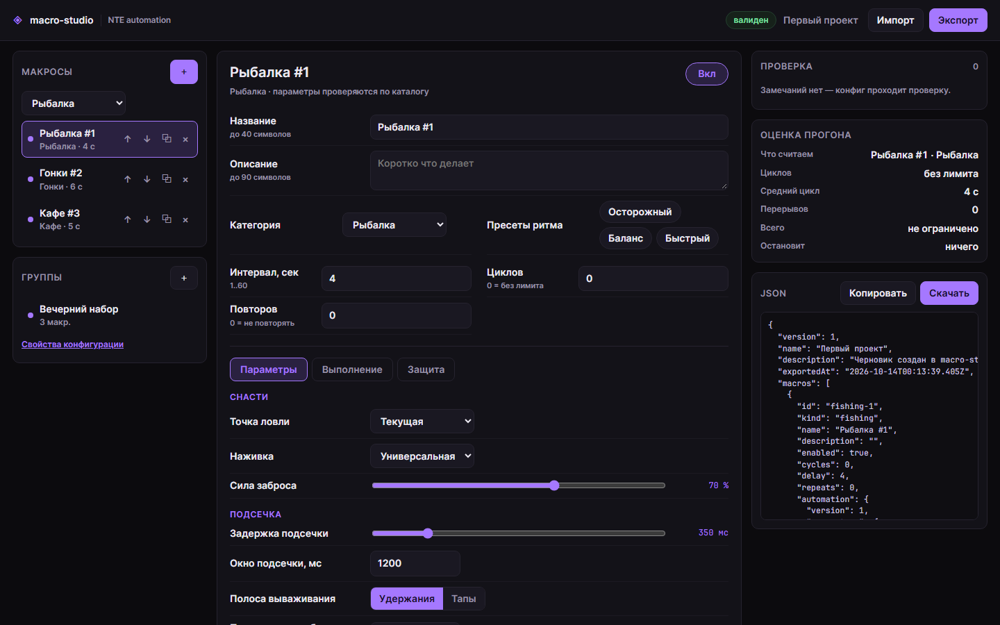

# macro-studio

Визуальный редактор и валидатор JSON-конфигураций автоматизации. Каталог категорий описывает
поля и параметры, а приложение следит за тем, чтобы файл прошёл импорт: границы чисел, перекрёстные
правила, ссылки групп, длина текстов.

Интерфейс работает в браузере, та же логика доступна из CLI — так конфиг можно проверять в CI
перед тем, как нести его в приложение.



## Возможности

- **Редактор макросов.** Категории и поля берутся из JSON-каталога, а не зашиты в код: новая
  категория — это файл, а не правка интерфейса.
- **Живая проверка.** Ошибки и предупреждения появляются при каждом изменении, по клику на
  замечание редактор переходит к нужному макросу или группе.
- **Перекрёстные правила.** «Окно подсечки больше задержки», «для своего маршрута нужно имя»,
  «без авторбора цель по находкам равна нулю» — описываются в каталоге.
- **Видимость по условию.** Поле `requires` показывает настройку только когда связана с ней опция
  выбрана, — форма не превращается в простыню.
- **Группы.** Состав, цвет `#RRGGBB`, проверка того, что группа не ссылается на удалённый макрос.
- **Оценка прогона.** Сколько циклов влезет в лимит времени, сколько будет перерывов и сколько
  это займёт — до запуска.
- **Пресеты ритма.** Осторожный / баланс / быстрый меняют только выполнение и защиту, параметры
  категории остаются как были.
- **Черновик в браузере.** Правки переживают перезагрузку; при открытии черновик нормализуется,
  так что починенный файл снова проходит проверку.
- **CLI `macro-check`.** Проверка, машиночитаемый отчёт `--json` и починка файла `--fix`.

## Быстрый старт

```bash
npm install
npm run dev        # http://localhost:5173
```

Сборка статической версии:

```bash
npm run build      # результат в web/
```

Проверка файла конфигурации:

```bash
npm run build:cli
node dist/cli/check.js samples/weekend.json
node dist/cli/check.js samples/broken.json          # код 1, разбор по строчкам
node dist/cli/check.js my.json --fix --out my-clean.json
```

## Формат конфигурации

Корень файла — `version: 1`. Дальше три блока: `macros`, `groups`, `settings`.

| Поле макроса | Границы | Комментарий |
| --- | --- | --- |
| `id` | `^[a-zA-Z0-9][a-zA-Z0-9_-]{0,79}$` | `constructor`, `prototype`, `__proto__` запрещены |
| `name` / `description` | ≤ 40 / ≤ 90 символов | имя не может быть пустым |
| `kind` | id из каталога | неизвестная категория — ошибка |
| `delay` | целое 1..60 | сек между циклами |
| `cycles` | целое ≥ 0 | 0 — без ограничения |
| `repeats` | целое 0..9999 | |
| `automation.version` | 1 | |

`automation.execution`: задержка старта 0..300 с, тип интервала `fixed`/`variable`, разброс
0..50 % с шагом 5, перерыв каждые 0..1000 циклов длительностью 5..600 с (шаг 5), лимит
0..480 мин, уведомления `silent`/`finish`/`all`.

`automation.safety`: порог распознавания 50..99 %, тайм-аут цикла 10..600 с (шаг 5), поведение при
ошибке `retry`/`skip`/`stop`, 0..5 повторов с паузой 1..60 с, пауза в фоновом окне, журнал
`errors`/`normal`/`verbose`.

Ограничения контейнера: не больше 200 макросов и 100 групп, файл до 1 МБ, `settings.shortcut` —
только `F6`, `F8` или `F9`. `settings.stopOnError` формат всегда держит `true`; если в файле
лежит другое значение, редактор предупредит и перепишет его.

Значение вне диапазона — ошибка. Число, не попадающее на шаг, — предупреждение: его никто не
отменяет, но оно выглядит как опечатка. Неизвестный параметр категории тоже предупреждение, и при
`--fix` он отбрасывается.

## Свой каталог

Каталог — это данные. `catalogs/nte-automation.json` содержит категории рыбалки, гонок, кафе,
заданий и артефактов; вместо него можно подложить свой файл:

```jsonc
{
  "version": 1,
  "title": "Мои категории",
  "kinds": [
    {
      "id": "mining",
      "label": "Разкоп",
      "delay": 6,
      "fields": [
        { "key": "depth", "label": "Глубина", "type": "range", "default": 3, "min": 1, "max": 10 },
        { "key": "mode", "label": "Режим", "type": "segments", "default": "fast",
          "options": [{ "value": "fast", "label": "Быстро" }, { "value": "safe", "label": "Бережно" }] }
      ],
      "rules": [
        { "id": "deep-safe", "type": "implies", "message": "Ниже 5 копай бережно.",
          "when": { "key": "depth", "min": 5 }, "then": { "key": "mode", "equals": "safe" } }
      ]
    }
  ]
}
```

Типы полей: `select`, `segments`, `toggle`, `range`, `number`, `multi`, `text`. Форма правил:
`ordered` (одно число меньше другого), `nonEmpty` (текст обязателен при выборе опции),
`requiresValue` (при одном значении другое обязано быть конкретным), `implies` (число выросло —
переключи опцию). Видимость поля — `requires`.

Сам каталог проходит `validateCatalog()` до первой проверки конфига: битая ссылка в правиле или
`default` вне диапазона ловятся сразу, а не всплывают странным поведением формы.

## CLI

```
macro-check <config.json> [--catalog path] [--fix [--out file]] [--json] [--warnings] [--quiet]
```

| Код | Значение |
| --- | --- |
| 0 | ошибок нет (предупреждения допустимы) |
| 1 | есть ошибки — конфиг не пройдёт импорт |
| 2 | неверный запуск, нет файла или битый JSON |

`--warnings` полезен в строгом CI: он поднимает предупреждения до уровня ошибки. `--fix` пишет
нормализованный конфиг — удобно, когда файл правят руками.

## Совместимость

Формат совпадает со структурой конфигураций Delkol: те же `version: 1`, `macros`/`groups`/`settings`,
те же границы и тот же блок `automation`. Каталог `nte-automation.json` — моя переработка набора
категорий; параметры, которых нет в рантайме приложения, молча отбрасываются при импорте, поэтому
редактор честно помечает их предупреждением. Проверить конкретный файл можно и без приложения:
`npm run check`.

## Тесты и CI

```bash
npm test           # node --test, 54 проверки
npm run typecheck
```

Ядро (`src/core`) не знает ни про браузер, ни про Node: оно покрыто тестами и используется и
интерфейсом, и CLI. GitHub Actions гоняет typecheck, тесты, сборку интерфейса и `macro-check` по
обоим образцам — валидному и сломанному.

## Ограничения

- Редактор правит файл конфигурации, но не запускает саму автоматизацию.
- Оценка прогона — арифметика по интервалам, а не предсказание игровых событий.
- Смена категории пересобирает параметры из каталога: совпадающие по `key` значения сохраняются,
  остальные возвращаются к дефолтам.
- Черновик лежит в `localStorage` браузера: очистка данных сотрёт его, а не конфиг.

## Лицензия

MIT — см. [LICENSE](LICENSE).
